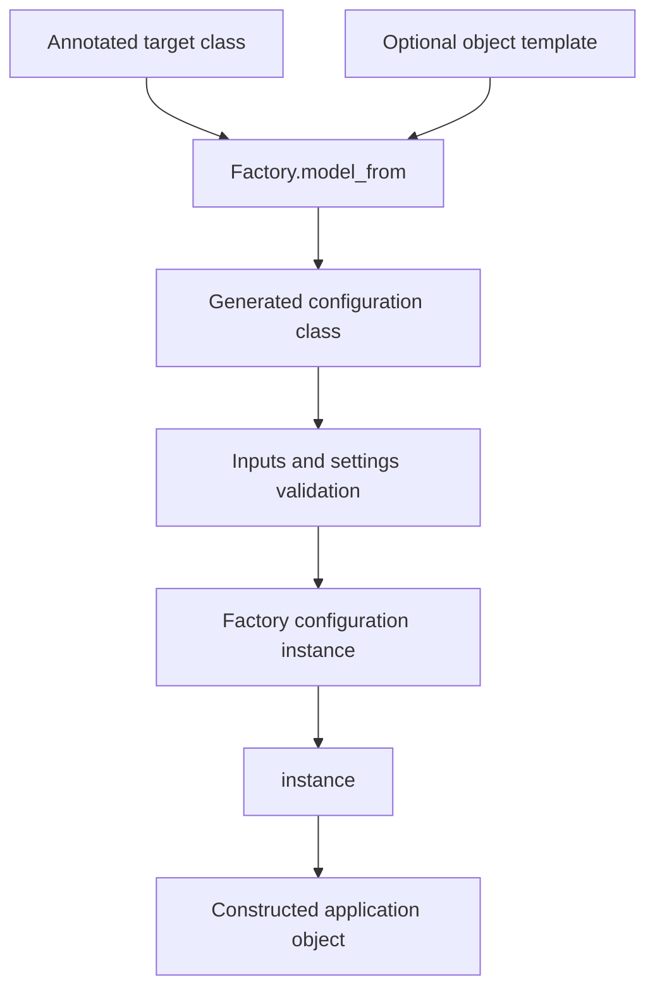

# From a constructor to an application object

Factories separate *describing construction* from *performing construction*. This
is useful when input errors should be found before the application opens resources.

`model_from` returns a class. Instantiating that class validates settings.
`instance` calls the target. The [factory guide](../guide/factories.md) gives
a runnable example of each stage.

## Generate the model

Annotated constructor parameters become fields; a template supplies matching
concrete defaults. Without constructor arguments, generating from a target class
does not instantiate it. Supplying constructor arguments to `model_from` first
constructs a template, so that form can already have constructor side effects.

With `__recursive__`, matching concrete defaults become nested generated factory
fields. This exposes their inputs to validation and dotted CLI options. Matching
uses the declared selection policy; generation does not invent missing required
objects or search through individual collection elements.

## Validate configuration

Generated classes inherit settings behavior, so source priority, nested merges,
and validation apply as they do for hand-written `BaseConfig` classes. Constructor
metadata identifies which fields are passed to the target. Extra configuration
fields are not automatically constructor arguments.

## Resolve explicitly

Resolution recursively constructs supported nested factory values, then calls the
target with its constructor fields. It does this whether or not generation used
`__recursive__`. Repeated occurrences are constructed separately, traversed cycles
fail, and arbitrary object attributes are not walked.

Automatic CLI parsing is suppressed throughout target construction and restored
on exit; other settings sources remain active. A target constructor can still
raise an application-specific error. Mutable template defaults have supported
copying rules, not a promise of universal deep copying for arbitrary objects.

For an outer `BaseConfig` holding factories, resolution returns a validated model
with resolved target annotations. A factory also inherits this model-preserving operation; `Factory.instance()`
constructs its target object.
Generated classes are not automatically importable names; portable factory
[Make directives](../advanced/object-directives-and-portability.md#make-directives)
identify their target constructors instead.

See the [wiki lifecycle](https://github.com/sztal/confidantic/blob/master/wiki/architecture/factory-lifecycle.md)
for generation caches, reconstruction, and internal resolution details.
