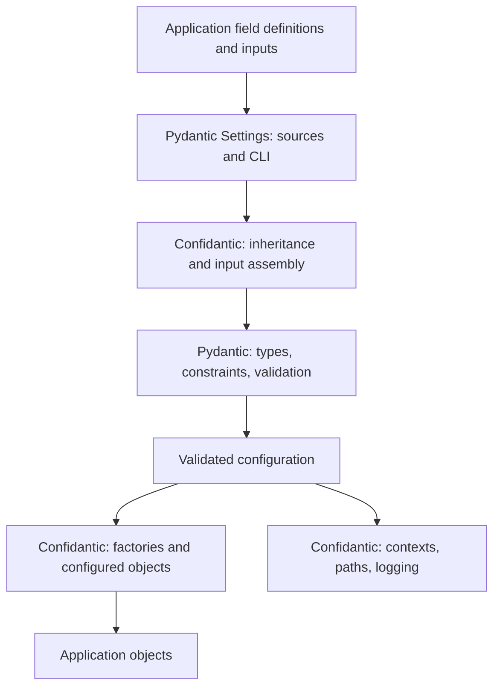

# How the package fits together

Confidantic connects validated data to application setup. Most users work with
`BaseConfig` and a few public helpers; the underlying libraries supply the general
validation and settings machinery.

The arrows show responsibilities in a typical use. These layers cooperate during
construction rather than running as three independent applications. Pydantic
validates fields; Pydantic Settings provides source and parser types; Confidantic
coordinates its inheritance, nested-input, and lifecycle rules around them.

## Public building blocks

| Feature            | Public entry points and further reading                                                                                                                   |
| ------------------ | --------------------------------------------------------------------------------------------------------------------------------------------------------- |
| Settings           | `BaseConfig` and `ConfigModelDict` collect, validate, copy, and serialize settings. See the [settings lifecycle](settings-lifecycle.md).                  |
| Factories          | `Factory` generates configuration from constructors and resolves it into objects. See the [factory lifecycle](factory-lifecycle.md).                      |
| Input parsing      | `annotations` provides convenient text parsing and explicit directives. Start with [input parsing](../guide/input-parsing.md).                            |
| Contexts           | `BaseContext` activates settings within an execution scope. See [contexts](../recipes/contexts.md).                                                       |
| Configured objects | `InstanceConfig` and `Configurable` associate durable inputs with runtime classes. See [configured objects](../recipes/configurable-objects.md).          |
| Infrastructure     | `BasePaths` and `BaseLogging` apply settings to common application infrastructure. See [paths](../recipes/paths.md) and [logging](../recipes/logging.md). |

The package root re-exports the main configuration types. Other facilities live
in their named public modules and are listed in the [API reference](../reference/api.md).
Private helpers under `_config` implement the coordination; application code
should use the public entry points.

## Optional integrations

Rich supplies display tables, docstring-parser handles requested `@attrs`
generation, PyYAML reads and writes YAML, and tomli-w writes TOML. They are imported
when used, so core settings do not need those extras. TOML reading uses Python's
standard library. See [installation](../getting-started/installation.md#optional-extras).

For maintenance-level module ownership, consult the
[wiki package map](https://github.com/sztal/confidantic/blob/master/wiki/architecture/package-map.md).
