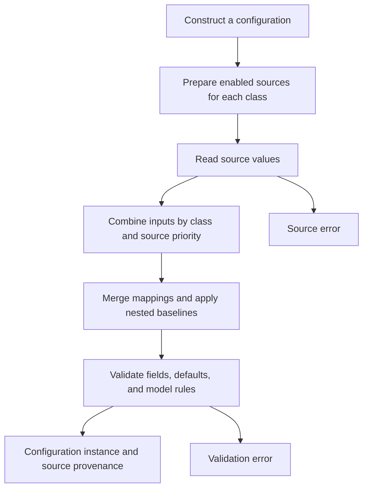

# From inputs to validated settings

Calling `AppConfig()` does more than assign defaults. It collects enabled inputs,
combines them using the class's policy, and asks Pydantic to validate the result.

This is a conceptual view. Source priority decides which supplied value wins;
all sources still execute. The [sources guide](../guide/sources.md) shows how to
configure them.

## 1. Prepare inputs for each class

Each level of configuration inheritance contributes its source policy. Only the
most-derived class parses CLI arguments. Environment and file options determine
which other inputs are read. A custom hook can replace or reorder sources within
one level.

## 2. Combine values

Child sources and defaults precede parent sources and defaults. Within a class,
the usual enabled order is CLI, initializer, environment, dotenv, secrets, then
declared defaults. That means a child default can outrank a parent environment
value; see the [worked example](../concepts/values-and-inheritance.md#child-classes-before-parents).

Mappings merge recursively; non-mappings replace lower-priority values. Nested
model instances can supply concrete baselines for partial updates. Ordinary
default factories stay lazy until field validation rather than being called just
to assemble sources. The [nested guide](../guide/nested-settings.md) explains
subtypes, replacement, and the validation-option boundary.

## 3. Validate and retain the result

Pydantic applies field types, constraints, and model validators to assembled input.
Defaults are validated too. A failure raises an error instead of returning a
partly initialized configuration. Successful construction retains values and
available top-level source provenance.

Validated copy updates enter settings construction again; structural copies without
updates do not. File loaders parse their format and then enter model validation,
where settings sources can still participate. This shared path explains why a CLI
option may override a copy update or a loaded document.

Custom constructors retain Pydantic's limitations on per-call validation options.
The existing nested-baseline reconstruction has a separate documented limitation;
see [files](../guide/files.md#yaml-and-toml) and [nested settings](../guide/nested-settings.md).

The [wiki lifecycle](https://github.com/sztal/confidantic/blob/master/wiki/architecture/settings-lifecycle.md)
traces the private helpers and validation scopes used to implement this flow.
